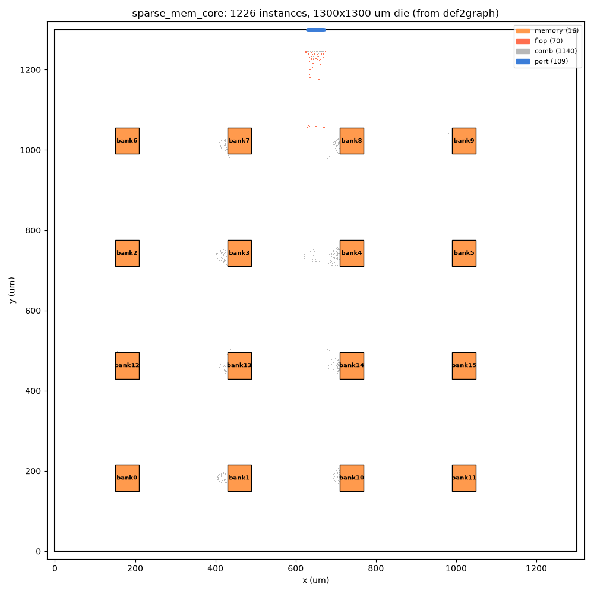

# placehead: placement headroom analysis

The test design is `sparse_mem_core`, copied from factory's `adapters/def2graph/examples/`.

## sparse_mem_core

A synthetic **48-bank SRAM core** (loosely an AI-inference scratchpad array) used
to exercise def2graph's **memory-boundary** handling at scale. It is *not* a
faithful accelerator model — it's a connectivity scaffold that produces the right
graph structure: many memory macros reached from ports both combinationally and
through flops, with read data flowing back to output ports.



48 tall `fakeram45_1024x32` SRAM banks (orange, 104×318 µm each) split into a
**left group and a right group with a vertical channel** between them, on a
2450×2200 µm die. The ~4,000 Nangate45 std cells (grey/red) fall into the channel
and the inter-bank gaps; the 115 I/O pins sit on the bottom edge.

## Files

| File | What it is |
|---|---|
| `gen.py` | Generator: emits the structural Verilog. Edit `NBANKS` / `MASTER` / `AW` / `DW` to change count, memory style, address and data widths |
| `sparse_mem_core.v` | Generated gate-level netlist (48 banks + ~4,000 cells) |
| `place.tcl` | OpenROAD placement script (floorplan → macro grid → pins → global/detailed place → `write_def`) |
| `sparse_mem_core_placed.def` | The placed DEF — ready-to-use def2graph input |
| `placement.png` | Floorplan figure above, drawn by `plot_placement.py` from def2graph's output |
| `plot_placement.py` | Draws the placement from def2graph's `nodes.parquet` and the DEF's `DIEAREA` |
| `make_graph_json.py` | Writes a graph JSON (format `placehead-graph/1`): def2graph's cones and every bank's wires on the placement, with pin positions from the LEF |
| `viewer.html` | The viewer. It holds no design: it loads `graph.json` beside it, or a graph JSON you open or drop on it |
| `fetch_pdk.sh` | Downloads the Nangate45 and fakeram45 LEF and Liberty files into `pdk/` (not checked in) |

## Structure

- Per-bank registered address (`DFF`) and shared registered write-data → port→flop→mem paths.
- Combinational per-bank select/enable (`bank_sel` decode → `we`/`ce`) → port→mem paths.
- Masked OR-reduction read path to a **combinational** output (`rdata_c`, so output
  ports reach `rd_out`) and a **registered** output (`rdata_r`).

## Reproduce

```bash
python3 gen.py        # regenerate the netlist (sparse_mem_core.v is included)

# place with OpenROAD (needs the Nangate45 PDK + fakeram45_1024x32 LEF/LIB and an
# openroad binary). Run place.tcl where Nangate45/*.lef|lib are visible, writing to /work.
openroad -exit place.tcl
```

## Run def2graph on it

def2graph lives in factory, at `adapters/def2graph`. It needs `networkx`, `pandas` and `pyarrow`.

```bash
./fetch_pdk.sh
PYTHONPATH=/path/to/factory/adapters/def2graph python3 -m def2graph \
  --def sparse_mem_core_placed.def --lef pdk/*.lef --lib pdk/*.lib \
  --out out/sparse_mem --formats parquet json
python3 plot_placement.py --def sparse_mem_core_placed.def --graph out/sparse_mem -o placement.png
python3 make_graph_json.py --def sparse_mem_core_placed.def --lef pdk/*.lef --graph out/sparse_mem -o out/sparse_mem_core.graph.json
```

Expected: `fakeram45_1024x32` classified as **memory** (LEF `CLASS BLOCK` + Liberty
`memory()`), **48/48 banks** detected as boundaries, and **1,968 memory endpoints**
(input ports → `we_in`/`ce_in`/`clk`; output ports ← `rd_out`), each with its
placement coordinate. Union graph ≈ 9.2k nodes / 13k edges.

## View a graph

`viewer.html` draws any graph JSON that `make_graph_json.py` writes. Open the viewer, then click
**Open graph file…** or drop the JSON on the page. The file stays in your browser.

On load, the viewer also looks for `graph.json` beside it. The published viewer has
`out/sparse_mem_core.graph.json` there. A browser does not let a page opened from disk read
files beside it, so open a local copy of `viewer.html` and load the JSON with the button.

## Placement headroom

`headroom.py` estimates how much shorter the port-to-memory paths get with a few moves:
relocating or flipping a bank, or moving one bus's pins along the bottom edge. It scores a
placement by the straight line between each path's two ends, the shortest a placer could make
it, as the worst path and as the total over bank pins. For each port budget it makes the best
port moves, then up to K bank moves, greedily.

```bash
python3 headroom.py out/sparse_mem_core.graph.json --k 8 --ports 2 --check-lp -o out/headroom.json
```

`--check-lp` also places the gates by a linear program. With no limit on gate area it matches the
straight-line score. The bank spacing, die margin, pin keep-out and grid step are our choices, at
the top of the file.

`headroom_viewer.html` shows the results: it loads `headroom.json` beside it, or a results file you
open. Pick which score the search lowers first and the port budget, then step through the bank moves.
It is published at https://claude.ai/artifact/Rszs9A9q233XLUYjJaiXhk (republish from this file, with
`out/headroom.json` as `headroom.json`, to keep that URL). The cone viewer, `viewer.html`, is at
https://claude.ai/artifact/YBtLdiyu2oh7Rz553Xg7V1 (with a graph JSON as `graph.json`).

### Next steps, not done yet

1. **Gate area.** Reserve the channel for logic, or charge each move for the area the gates need,
   so a move does not take the space the OR trees and decoders sit in now.
2. **A real placer.** Place two or three of the results with OpenROAD (not installed here; run it in
   Docker) and measure the paths, to replace the straight-line bounds with real lengths.
