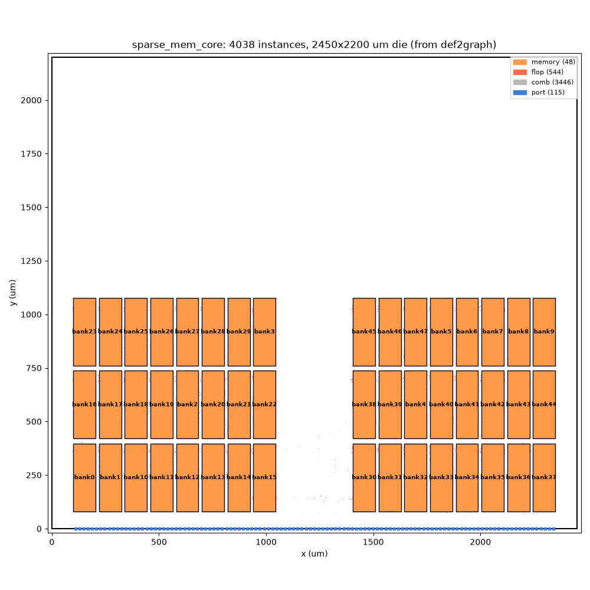

# sparse_mem_core: a synthetic design to try the skill on

This design holds no secrets. Use it to run the export workflow end to end before you run it on
your own design. It is a connectivity scaffold, not a model of a real chip.



48 `fakeram45_1024x32` SRAM memories (orange, 104.5 x 317.8 um each) sit in a left group and a
right group, with a vertical channel between them, on a 2450 x 2200 um die. About 4,000 Nangate45
standard cells sit in the channel and in the gaps between memories. The 115 top-level pins sit on
the bottom edge.

## Run the workflow on it

```bash
examples/sparse_mem_core/run_demo.sh
```

The script downloads the open Nangate45 and fakeram45 LEF and Liberty files into `pdk/` (from
OpenROAD's test directory on GitHub), then runs extract, obfuscate, verify and audit. It writes
`demo/work/` (real names) and `demo/export/design.export.json` (the file a partner would send).
Both directories are ignored by git. The audit should end with `RESULT: PASS`.

## Structure

- Each memory has a registered address (flip-flops beside the memory). Write data is registered
  once, near the pins, and shared. These give port-to-flop-to-memory paths.
- Memory select and write enable come from a decoder of `bank_sel`, with no register. These give
  port-to-memory paths.
- Read data goes through a masked OR tree to a combinational output, `rdata_c`, and to a
  registered output, `rdata_r`.

## Files

| File | Holds |
|---|---|
| `gen.py` | Writes the structural Verilog. Change `NBANKS`, `MASTER`, `AW` or `DW` for another memory count, memory type, address width or data width |
| `sparse_mem_core.v` | The generated gate-level netlist |
| `place.tcl` | The OpenROAD script that placed it: floorplan, memory grid, pins, global and detailed placement, `write_def` |
| `sparse_mem_core_placed.def` | The placed DEF |
| `fetch_pdk.sh` | Downloads the LEF and Liberty files into `pdk/` |
| `run_demo.sh` | Runs the export workflow on this design |
| `plot_placement.py` | Draws `placement.png` from def2graph's output |

To redraw the figure after `run_demo.sh`:

```bash
python3 plot_placement.py --def sparse_mem_core_placed.def --graph demo/work/graph -o placement.png
```

To place it again, you need OpenROAD and the Nangate45 files: `python3 gen.py`, then
`openroad -exit place.tcl`.
